<p align="center">
  
</p>

<p align="center">
  <strong>A local-first, deterministic fulfillment decision system.</strong><br/>
  Allocate orders across fulfillment nodes, calculate carrier-aware delivery promises, and trace every shipment outcome.
</p>

<p align="center">
  
  
  
  
</p>

<p align="center">
  <a href="#overview">Overview</a> ·
  <a href="#capabilities">Capabilities</a> ·
  <a href="#run-locally">Run locally</a> ·
  <a href="#data-and-validation">Data & validation</a> ·
  <a href="#technical-notes">Technical notes</a>
</p>

---

## Overview

FulfillIQ is a synthetic fulfillment-network simulator and operator control tower built for the **YottaFlex AI Associate AI Forward Deployed Engineer challenge**.

It models the workflow from order creation to fulfillment allocation, delivery promise calculation, shipment tracking, and order-level delivery status. The bundled starter database contains **250 orders** so reviewers can run the application immediately. The same deterministic generator supports the challenge-scale target of **50,000 orders, 20 nodes, 10 carriers, and 100,000 tracking events**.

> **Operating boundary:** This is a local simulation, not a live retailer, warehouse, or carrier integration. It uses synthetic data, SQLite, and local services. No API keys or paid cloud services are required.

## At a glance

| Area | What FulfillIQ demonstrates |
|---|---|
| Allocation | Inventory-, capacity-, carrier-, zone-, calendar-, and cutoff-aware node selection |
| Promise dates | Business-day calculations using service levels and operating calendars |
| Split fulfillment | One order can be assigned to multiple nodes and shipments |
| Traceability | Shipment tracking and order-state changes retained as event records |
| Data quality | Relational integrity, lifecycle, arithmetic, and reconciliation checks |
| Reproducibility | Fixed seed, deterministic identifiers, manifests, and SHA-256 checksums |

## Capabilities

| Workspace | Reviewer can inspect |
|---|---|
| **Control Tower** | Order volume, delivery performance, order states, node utilization, carrier reliability, and exceptions |
| **Order Command** | Order lines, shipment allocation, promises, carriers, and tracking-event history |
| **Allocation Lab** | A read-only decision preview with feasible node/carrier candidates and decision reasons |
| **Network Health** | Fulfillment-node capacity and carrier performance |
| **Data Assurance** | SQL-backed validation results and the five isolated negative scenarios |

## Decision flow

```mermaid
flowchart LR
    A[Order and order lines] --> B[Check inventory]
    B --> C[Check node capacity]
    C --> D[Check carrier, zone and cutoff]
    D --> E[Rank feasible node-carrier options]
    E --> F[Calculate dispatch and promise dates]
    F --> G[Create shipment and tracking events]
    G --> H[Roll up order delivery status]
    H --> I[Validation and audit trail]
```



## Run locally

**Requirements:** Python 3.10 or later. The application uses the Python standard library; `pytest` is used for the test suite.

### Windows PowerShell

```powershell
# From the repository root
py -3 -m venv .venv
.\.venv\Scripts\Activate.ps1
py -3 -m pip install -r requirements.txt

# Start the bundled 250-order application
py -3 -m fulfilliq.cli serve
```

Open **http://127.0.0.1:8765** in your browser. Stop the local server with `Ctrl+C`.

### macOS / Linux

```bash
python3 -m venv .venv
source .venv/bin/activate
python -m pip install -r requirements.txt
python -m fulfilliq.cli serve
```

### Run tests and validate the starter data

```powershell
# The importlib mode avoids the duplicate test_engine.py module-name collision.
py -3 -m pytest --import-mode=importlib -q

py -3 -m fulfilliq.cli validate --orders 250 --events 500
```

The candidate's local verification run completed **10 tests**, with **30/30 database validation checks** and **5/5 ground-truth anomaly cases** passing.

## Generate the challenge-scale dataset

The starter database and full-scale build use the same generator and business rules. To generate the assessment target:

```powershell
py -3 -m fulfilliq.cli generate --orders 50000 --nodes 20 --carriers 10 --skus 500 --events 100000 --seed 20261022 --output data/generated
```

Validate the generated database:

```powershell
py -3 -m fulfilliq.cli validate --db data/generated/fulfilliq.db --orders 50000 --events 100000
```

Full-scale output is written to `data/generated/` and is excluded from Git so the source repository stays small. The generator also supports a same-seed reproducibility comparison:

```powershell
py -3 -m fulfilliq.cli reproduce --orders 1000 --seed 20261022
```

## Data model and integrity

The schema covers the challenge's core entities: `Order`, `OrderLine`, `SKU`, `FulfillmentNode`, `Inventory`, `WarehouseCapacity`, `Carrier`, `ServiceLevel`, `Shipment`, `TrackingEvent`, and `DeliveryPromise`. Supporting bridge and event tables model carrier service zones, calendars, shipment-line allocation, and order-state history.

Five requested negative scenarios are stored separately in `ground_truth.csv` and `ground_truth.json`; they are not injected into the valid baseline records:

1. Promise before order time.
2. Allocation exceeds available stock.
3. Carrier service unsupported for the destination zone.
4. Shipment delivered before dispatch.
5. Split-shipment status incorrectly rolled up.

## Repository map

```text
fulfilliq/
├── fulfilliq/       # Configuration, schema, generator, validation, API and CLI
├── web/             # Local operator dashboard
├── data/sample/     # Bundled starter SQLite database and supporting exports
├── docs/            # Architecture, decision policy, data dictionary and validation notes
├── tests/           # Automated tests
├── PROMPT_HISTORY.md
├── SUBMISSION_CHECKLIST.md
└── README.md
```

## Technical notes and assumptions

- **Allocation policy:** feasible node/carrier combinations are evaluated using inventory, capacity, service-zone support, operating calendars, cutoff times, transit, cost, and reliability inputs. The candidate score and assumptions are documented in [`docs/DECISION_POLICY.md`](docs/DECISION_POLICY.md).
- **Split orders:** each child shipment retains its own promise and event history. The order is considered delivered only when all child shipments are delivered; its committed promise reflects the latest child-shipment promise.
- **Synthetic outcomes:** delivery-delay outcomes are derived from documented carrier reliability parameters and a stable seed/shipment signal, rather than assigned independently at random.
- **Preview behavior:** the Allocation Lab is read-only. It evaluates a hypothetical basket and does not reserve inventory.
- **Production boundary:** live warehouse/carrier integrations, atomic reservations, concurrency control, authentication, and production deployment hardening are out of scope.

## API surface

| Method | Endpoint | Purpose |
|---|---|---|
| `GET` | `/api/health` | Runtime and database health |
| `GET` | `/api/summary` | Dashboard metrics and network overview |
| `GET` | `/api/orders` | Search, filter, and paginate orders |
| `GET` | `/api/orders/{order_id}` | Order, lines, shipments, events, and allocation details |
| `GET` | `/api/skus` | SKU catalogue for allocation preview |
| `GET` | `/api/validation` | Validation checks and anomaly coverage |
| `POST` | `/api/decision` | Read-only allocation recommendation |

## Documentation

- [Architecture](docs/ARCHITECTURE.md)
- [Decision policy and scoring](docs/DECISION_POLICY.md)
- [Data dictionary](docs/DATA_DICTIONARY.md)
- [Validation approach](docs/VALIDATION.md)
- [Challenge requirement mapping](docs/CHALLENGE_MAPPING.md)
- [Demo walkthrough](docs/DEMO_SCRIPT.md)
- [AI prompt history and disclosure](PROMPT_HISTORY.md)
- [Submission checklist](SUBMISSION_CHECKLIST.md)

---

<p align="center">
  <strong>FulfillIQ</strong><br/>
  <sub>Deterministic by design. Explainable by default. Traceable end to end.</sub>
</p>
