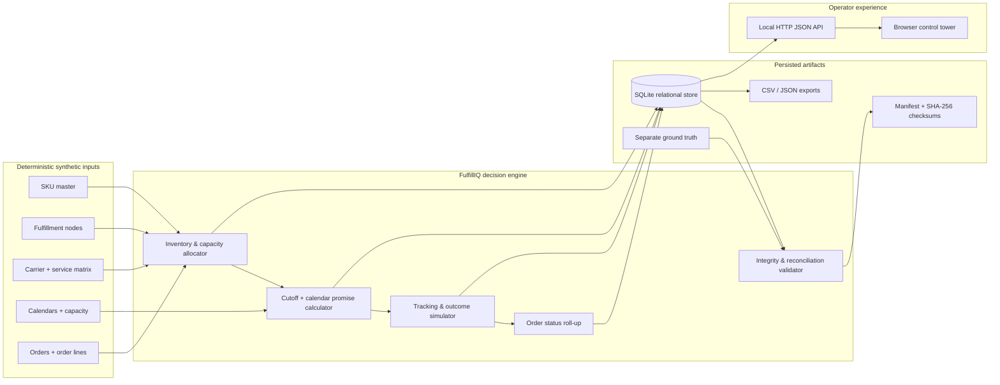

# FulfillIQ architecture

## System view

## Runtime boundaries

- `generator.py` is the deterministic build pipeline. It creates parent/master entities, dependent transactions, reservations, shipments, tracking history, promise outcomes and exports.
- `schema.py` is the canonical SQLite relational schema. Primary keys, foreign keys, uniqueness constraints and arithmetic checks are enforced by SQLite.
- The allocator lives inside the chronological transaction build. It only commits a shipment after checking SKU availability, daily node capacity and carrier/service/zone support.
- `server.py` is a standard-library HTTP API and static-file host. No cloud account, API key, database server or third-party service is needed.
- `web/` is the operator console. It reads API results and renders dashboards, order traces, network health, validation evidence and stateless decision previews.
- `validation.py` independently queries the persisted database. It does not trust generator counters for the integrity checks.

## Data flow

1. Generate master data: SKU, node, carrier, service level, carrier/service/zone bridge, carrier calendar, holiday, inventory and daily capacity.
2. Generate orders and unique order lines with deterministic identifiers.
3. Process orders in timestamp order. Rank feasible node/carrier options and reserve inventory/capacity in in-memory ledgers.
4. Group allocated order lines by node into shipment records and a `shipment_line` bridge.
5. Calculate shipment promise windows from cutoff-aware dispatch dates and carrier operating calendars. Roll the order promise up to the latest child shipment promise.
6. Derive delivery outcomes from a documented carrier reliability rule plus a stable per-shipment hash signal.
7. Append order-state and tracking events. Do not rewrite prior event rows.
8. Persist to SQLite, export CSV/JSON, write the separate anomaly fixture, manifest and file checksums.
9. Run database-level checks and make the same data available to the browser UI.

## Relationship cardinality

- Order 1:N OrderLine, Shipment and OrderStatusEvent.
- Order 1:1 DeliveryPromise in the simulation (the row may explicitly say `UNAVAILABLE`).
- SKU 1:N OrderLine and Inventory.
- FulfillmentNode 1:N Inventory, WarehouseCapacity and Shipment.
- OrderLine N:M Shipment through `shipment_line`.
- Carrier 1:N Shipment and CarrierCalendar.
- Carrier N:M (ServiceLevel, zone) through `carrier_service_zone`.
- Shipment 1:N TrackingEvent.

## Design trade-offs

- **SQLite over a distributed database:** makes the assessment runnable with no infrastructure, while still enforcing relational integrity and supporting 50k orders / 100k events.
- **Synthetic data over external data:** avoids personal data and redistribution/licensing ambiguity. Carrier names and reliability are fictional simulation parameters.
- **Deterministic rules over opaque ML:** the brief evaluates fulfillment constraints and data correctness, not model accuracy. Rule traces are easier to defend and reproduce.
- **Local HTTP + vanilla JS over a hosted frontend:** removes build tooling and cloud dependencies, making the submission easy to run on a reviewer laptop.
- **Ground truth isolated from baseline:** intentionally invalid examples are not ingested into operational tables or exposed as operational features.
